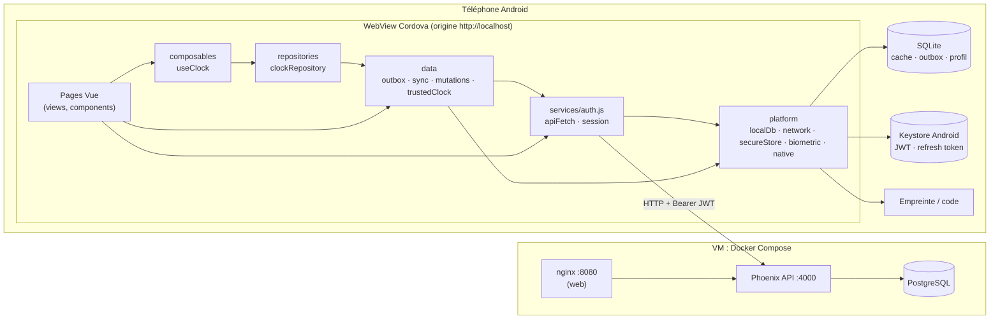
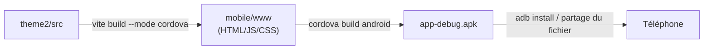
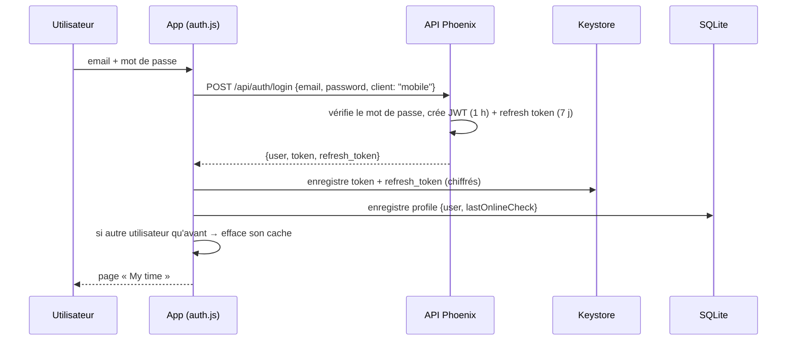
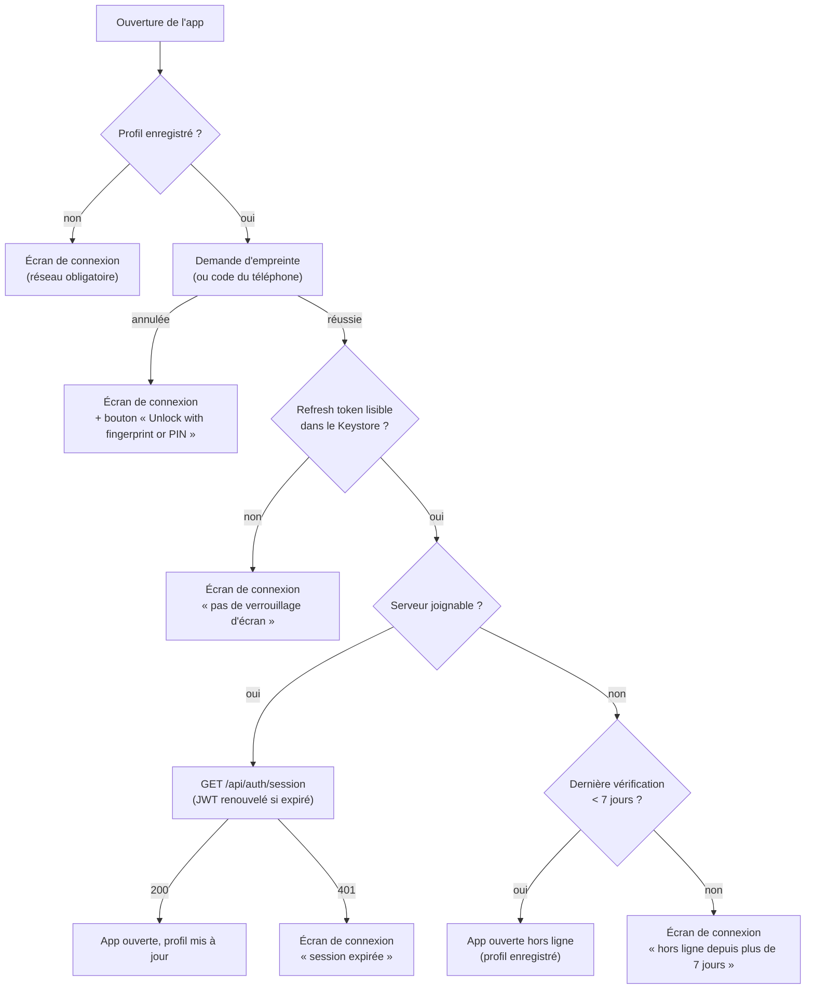
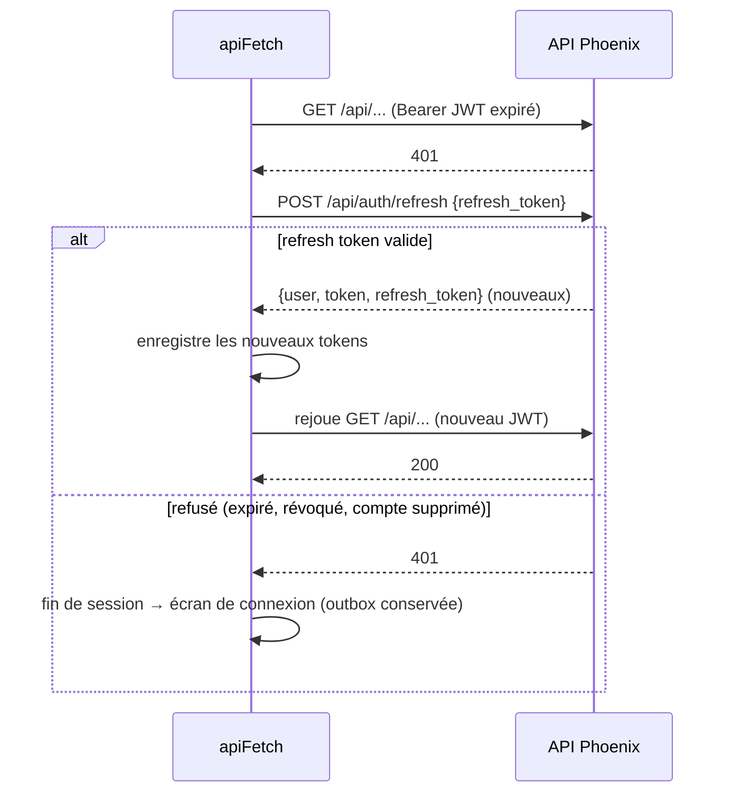
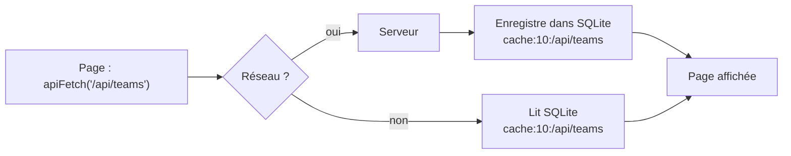
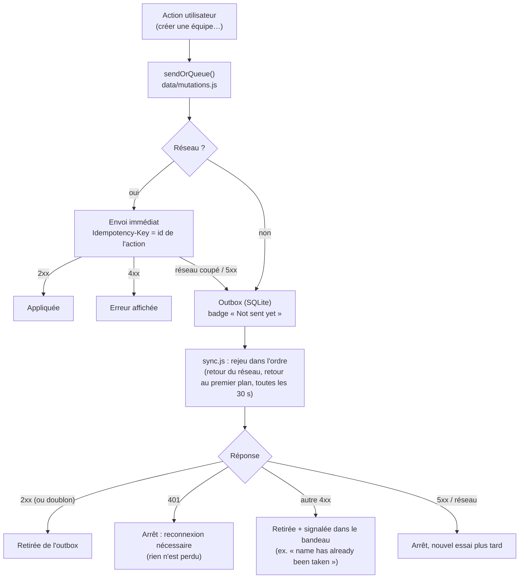
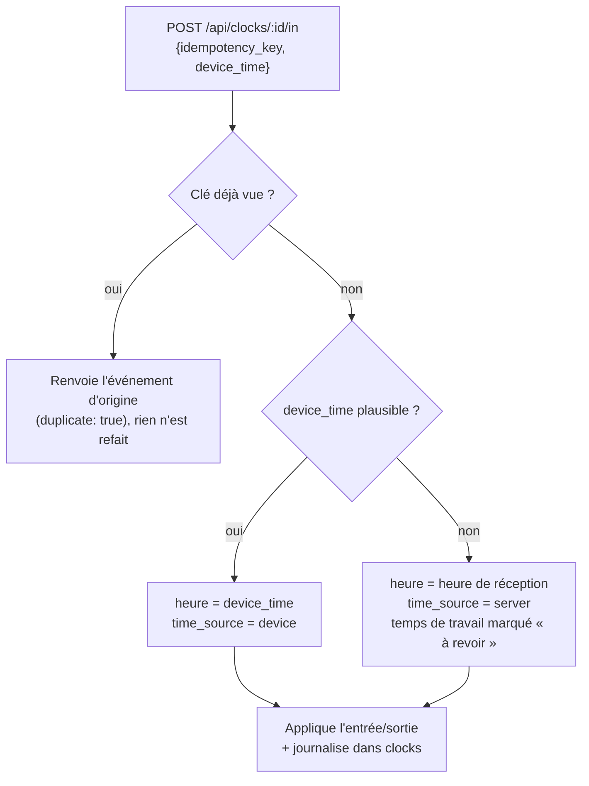

# Time Manager — Application mobile et mode hors ligne

Documentation technique de l'application mobile (Android, Cordova) : ce qui a changé dans le front (`theme2`) et le back (`theme1`), l'architecture, et ce qui se passe à l'exécution.

> **Public** : développeurs de l'équipe et évaluateurs.
> **Branche** : `feature/mobile-cordova`.
> **Backend de démonstration** : `http://145.241.169.233:4000` (VM Oracle).

---

## Sommaire

1. [En résumé](#1-en-résumé)
2. [Architecture générale](#2-architecture-générale)
3. [Build et configuration mobile](#3-build-et-configuration-mobile)
4. [Authentification mobile](#4-authentification-mobile)
5. [Mode hors ligne : couches du front](#5-mode-hors-ligne--couches-du-front)
6. [Pointage hors ligne](#6-pointage-hors-ligne)
7. [Ce qui fonctionne hors ligne, page par page](#7-ce-qui-fonctionne-hors-ligne-page-par-page)
8. [Changements côté backend](#8-changements-côté-backend)
9. [Navigation et routes sur mobile](#9-navigation-et-routes-sur-mobile)
10. [Choix de sécurité](#10-choix-de-sécurité)
11. [Tests réalisés](#11-tests-réalisés)
12. [Dépannage](#12-dépannage)
13. [Limites connues et pistes](#13-limites-connues-et-pistes)

---

## 1. En résumé

L'application web Vue (`theme2`) est empaquetée en application Android avec **Cordova** (`mobile/`). Le même code sert au web et au mobile ; un mode de build (`--mode cordova`) active les comportements propres au mobile.

Ce que le mobile apporte par rapport au web :

| Fonction | Comment |
|---|---|
| Session sans cookie | JWT d'une heure en en-tête `Authorization: Bearer`, renouvelé par un **refresh token** révocable de 7 jours |
| Session protégée | Tokens chiffrés dans le **Keystore Android**, déverrouillés par **empreinte** (ou code du téléphone) |
| Lecture hors ligne | Chaque réponse `GET` est gardée sur le téléphone (SQLite) et resservie sans réseau |
| Écriture hors ligne | Les actions autorisées vont dans une **outbox** persistante, rejouée au retour du réseau |
| Pas de doublon | Chaque action porte une **clé d'idempotence** ; le serveur ne l'applique qu'une fois |
| Heure fiable | Un pointage hors ligne garde l'**heure réelle**, validée par le serveur |
| Pas de tableau de bord | Les dashboards et graphiques sont réservés au web |

Le principe de sécurité : **le hors ligne permet de travailler, pas de contourner le serveur**. Tout ce qui est fait hors ligne est revérifié par le serveur à la synchronisation.

---

## 2. Architecture générale



### Organisation du code front

Les nouveaux dossiers suivent une séparation en couches : chaque couche n'utilise que celles du dessous.

```text
theme2/src/
├── platform/        Accès natif, sans logique métier
│   ├── localDb.js       Stockage clé-valeur durable : SQLite (mobile) / localStorage (web)
│   ├── network.js       État du réseau, réactif (plugin network-information)
│   ├── secureStore.js   Secrets chiffrés dans le Keystore (plugin secure-storage-echo)
│   ├── biometric.js     Déverrouillage par empreinte ou code (plugin fingerprint-aio)
│   └── native.js        Dialogues natifs (plugin dialogs)
├── data/            Infrastructure hors ligne, commune à tous les domaines
│   ├── outbox.js        File persistante des actions à envoyer
│   ├── sync.js          Rejeu de l'outbox quand le réseau le permet
│   ├── mutations.js     « Envoyer maintenant ou mettre en file » (sendOrQueue)
│   └── trustedClock.js  Estimation de l'heure du serveur
├── repositories/    Accès aux données d'un domaine (online + offline)
│   └── clockRepository.js
├── composables/     État réactif d'un domaine pour les composants
│   └── useClock.js
├── services/
│   ├── auth.js          apiFetch, session web et session mobile
│   ├── signOut.js       Déconnexion avec avertissement si actions non envoyées
│   └── feedback.js      Sons et vibrations (pointage, erreurs)
└── utils/
    ├── platform.js      isMobileApp (build cordova ou non)
    ├── navigation.js    Liens de navigation par rôle
    ├── datetime.js      Dates UTC ↔ heure locale, formatRange
    ├── workingHours.js  Heures par jour / par semaine
    └── roles.js         Libellés des rôles
```

---

## 3. Build et configuration mobile

### 3.1 Chaîne de build



| Commande | Effet |
|---|---|
| `cd theme2 && npx vite build --mode cordova` | Génère le site dans `mobile/www` |
| `cd mobile && npx cordova build android` | Produit `mobile/platforms/android/app/build/outputs/apk/debug/app-debug.apk` |
| `cd theme2 && npm run android` | Les deux, puis installe et lance sur l'appareil ou l'émulateur branché |
| `adb install -r <apk>` | Installe l'APK sur un téléphone branché en USB |

### 3.2 Ce que change le mode `cordova` (`theme2/vite.config.js`)

| Réglage | Valeur | Raison |
|---|---|---|
| `base` | `./` | Les fichiers sont chargés depuis le téléphone, pas depuis un serveur |
| `build.outDir` | `../mobile/www` | Dossier lu par Cordova |
| `build.target` | `chrome69` | Compatible avec les anciennes WebView Android |
| Plugin `inject-cordova-js` | ajoute `<script src="cordova.js">` | Accès aux plugins natifs |
| `import.meta.env.MODE` | `"cordova"` | Lu par `utils/platform.js` (`isMobileApp`) |

Dans `main.js`, l'application ne démarre qu'après l'événement `deviceready`, pour que les plugins soient prêts.

### 3.3 Adresse du backend

Deux fichiers doivent toujours désigner **la même adresse** :

```bash
# theme2/.env.cordova  (sans barre finale)
VITE_API_BASE_URL=http://145.241.169.233:4000
```

```xml
<!-- mobile/config.xml : liste blanche Cordova des requêtes réseau -->
<access origin="http://145.241.169.233:4000" />
<allow-navigation href="http://145.241.169.233:4000/*" />
```

| Cible | Adresse |
|---|---|
| Émulateur Android → backend sur le PC | `http://10.0.2.2:4000` |
| Téléphone → backend sur le PC (même Wi-Fi) | `http://<IP Wi-Fi du PC>:4000` |
| Téléphone → VM | `http://145.241.169.233:4000` |

Autres réglages de `config.xml` : `scheme = http` (l'app est servie depuis `http://localhost`, origine acceptée par le CORS du backend) et `usesCleartextTraffic = true` (HTTP non chiffré autorisé tant que le backend n'est pas en HTTPS).

### 3.4 Plugins Cordova

| Plugin | Utilisé par | Rôle |
|---|---|---|
| `cordova-sqlite-storage` | `platform/localDb.js` | Cache, outbox, profil (durable, non effacé par Android) |
| `cordova-plugin-network-information` | `platform/network.js` | Savoir si le téléphone a du réseau |
| `cordova-plugin-secure-storage-echo` | `platform/secureStore.js` | JWT et refresh token chiffrés (Keystore) |
| `cordova-plugin-fingerprint-aio` | `platform/biometric.js` | Empreinte, avec repli sur le code du téléphone |
| `cordova-plugin-dialogs` | `platform/native.js` | Confirmations natives |
| `cordova-plugin-vibration` | `services/feedback.js` | Vibrations du pointage |

---

## 4. Authentification mobile

### 4.1 Pourquoi le mobile ne peut pas utiliser le cookie

L'application est servie depuis `http://localhost` (WebView) et l'API depuis `http://145.241.169.233:4000`. Ce sont deux sites différents : le cookie `SameSite=Lax` du web n'est **jamais envoyé** par la WebView. Le mobile transporte donc le même JWT autrement.

| | Web | Mobile |
|---|---|---|
| Fabrication du JWT | au login | identique |
| Transport vers le client | cookie `HttpOnly` | corps JSON de la réponse au login |
| Conservation | navigateur | Keystore Android (chiffré) |
| Envoi | automatique (cookie) + en-tête `X-CSRF-Token` | en-tête `Authorization: Bearer <JWT>` |
| Durée du JWT | 24 h | **1 h** |
| Renouvellement | nouvelle connexion | **refresh token** de 7 jours, renouvelé à chaque usage |
| Contrôle CSRF | oui | non (inutile : un en-tête n'est jamais ajouté automatiquement par le navigateur) |

### 4.2 Ce qui est stocké, et où

| Donnée | Emplacement | Pourquoi |
|---|---|---|
| JWT (1 h) | Keystore (`secureStore`) | Preuve d'identité : chiffrée |
| Refresh token (7 j) | Keystore (`secureStore`) | Permet de renouveler le JWT sans mot de passe |
| Profil (id, nom, email, rôle) + date de dernière vérification | SQLite, clé `profile` | Ouvrir la bonne interface hors ligne ; limiter la durée hors ligne |
| Dernier utilisateur | SQLite, clé `lastUserId` | Effacer le cache si quelqu'un d'autre se connecte |
| **Mot de passe** | **jamais** | Voir [Choix de sécurité](#10-choix-de-sécurité) |

### 4.3 Première connexion (en ligne, obligatoire)



Sans réseau, le login affiche : *« No connection. The first sign-in needs the network… »*. Seul le serveur peut vérifier un mot de passe.

Si le téléphone n'a **pas de verrouillage d'écran**, Android refuse le Keystore. Les tokens restent alors en mémoire seulement, et un avertissement s'affiche dès la connexion (voir [Dépannage](#12-dépannage)).

### 4.4 Ouvertures suivantes (en ligne ou hors ligne)



Points clés :

- **Une seule demande de déverrouillage.** L'empreinte est demandée *avant* de lire le Keystore. La clé du Keystore est liée au déverrouillage du téléphone ; une empreinte ou un code valide l'autorise, ce qui évite une seconde demande.
- Si le Keystore refuse malgré tout (*« User not authenticated »*), `secureStore.get` rouvre le stockage : le plugin affiche l'écran de code Android, puis relit le token.
- Le téléphone **ne vérifie pas** le JWT (il faudrait la clé secrète du serveur). Le déverrouillage prouve au téléphone que son propriétaire est là ; la vraie vérification a lieu côté serveur, à chaque requête.

### 4.5 Renouvellement transparent du JWT



- Un seul refresh à la fois : plusieurs 401 simultanés attendent le même renouvellement.
- Chaque refresh **remplace** le refresh token : l'ancien devient invalide.
- Si une session se termine en arrière-plan (par exemple pendant une synchronisation), le routeur ramène à l'écran de connexion.

### 4.6 Déconnexion

| Action | Effet |
|---|---|
| **Fermer l'app** | Rien n'est effacé : la prochaine ouverture se fait par empreinte |
| **Sign out** | Le refresh token est révoqué sur le serveur (`POST /api/auth/revoke`), puis les tokens et le profil sont effacés du téléphone. La prochaine connexion demande le mot de passe (réseau requis) |
| **Sign out avec actions non envoyées** | Dialogue natif : *« 2 actions are not synchronised yet… Sign out anyway? »*. Les actions restent sur le téléphone et partent à la prochaine connexion du même utilisateur |
| **Sign out hors ligne** | Session effacée du téléphone ; le refresh token ne peut pas être révoqué et expire seul (7 jours au plus) |

### 4.7 Garde-fous

| Situation | Comportement |
|---|---|
| Hors ligne depuis moins de 7 jours | Session locale acceptée |
| Hors ligne depuis plus de 7 jours | Connexion en ligne exigée |
| Retour du réseau | Session revérifiée auprès du serveur avant toute synchronisation |
| Mot de passe changé ou réinitialisé | Tous les refresh tokens de l'utilisateur sont révoqués |
| Compte supprimé | Tous ses refresh tokens sont révoqués |
| Refresh token déjà utilisé présenté à nouveau | Considéré comme volé : **tous** les tokens de l'utilisateur sont révoqués |
| Erreur serveur (5xx) au démarrage | Traitée comme « injoignable », pas comme « déconnecté » |
| Autre utilisateur sur le téléphone | Cache du précédent effacé ; ses actions en attente restent séparées (chaque action porte un `userId`) |

---

## 5. Mode hors ligne : couches du front

### 5.1 Lecture hors ligne (cache transparent)

Toutes les lectures passent par `apiFetch` (`services/auth.js`). Sur mobile :

1. Chaque `GET` réussi est enregistré dans SQLite sous la clé `cache:<userId>:<chemin>`.
2. Sans réseau, `apiFetch` renvoie la dernière réponse enregistrée, avec l'en-tête `X-Cached-At` (date d'enregistrement, lisible avec `cachedAt(response)`).



Avantage : **aucune page n'a eu besoin d'être modifiée pour lire hors ligne**. Une page jamais ouverte en ligne n'a pas de copie ; elle affiche un message.

### 5.2 Écriture hors ligne : outbox, synchronisation, idempotence



**Un élément de l'outbox** :

```jsonc
{
  "id": "6f0c…",               // sert aussi d'Idempotency-Key
  "userId": 10,
  "type": "team",               // domaine : clock, team, correction, account
  "label": "Create team \"Night shift\"",
  "method": "POST",
  "path": "/api/teams",
  "body": { "name": "Night shift" },
  "meta": { "kind": "create", "name": "Night shift" },  // pour l'affichage avant envoi
  "okStatuses": [404],          // optionnel : codes qui valent succès (ex. membre déjà retiré)
  "createdAt": "2026-10-14T09:30:35.000Z",
  "attempts": 0
}
```

**Déclencheurs de la synchronisation** (`sync.start()` dans `main.js`) : retour du réseau, retour de l'app au premier plan (`resume`, `visibilitychange`), toutes les 30 secondes s'il reste des actions, et au démarrage. Avant de rejouer, la session est revérifiée (`revalidateSession`). Seules les actions de l'utilisateur connecté sont envoyées.

**Pourquoi l'idempotence est indispensable** : si la réponse à une requête se perd (réseau coupé juste après l'envoi), l'app ne sait pas si le serveur l'a appliquée. Elle la remet en file avec la même clé ; au rejeu, le serveur reconnaît la clé et renvoie la réponse d'origine sans recréer l'équipe.

### 5.3 Interface

| Élément | Rôle |
|---|---|
| `OfflineBanner.vue` (dans `AppLayout`, toutes les pages) | « Offline » ; nombre d'actions en attente (« Waiting to send » / « Sending ») ; actions refusées avec la raison ; avertissement « pas de verrouillage d'écran » |
| Badge **« Not sent yet »** | Sur l'équipe créée, le membre ajouté, la demande de correction ou le pointage non encore envoyés |
| `OnlineOnlyNote.vue` | « Connection required for this action » sous les boutons désactivés hors ligne |

---

## 6. Pointage hors ligne

C'est le cas le plus abouti : il suit toute la chaîne `Clock.vue → useClock → clockRepository → outbox/sync`.

### 6.1 Côté app

1. **Clic sur « Clock In »** : le son est débloqué tout de suite (`unlockAudio`), car un son joué après une réponse réseau peut être bloqué par la WebView.
2. `clockRepository.clock()` prépare l'action avec une clé d'idempotence et l'**heure estimée du serveur** (`trustedClock.now()`).
3. En ligne : envoi immédiat. Hors ligne, ou si la requête échoue : mise en file.
4. L'écran affiche aussitôt « Clocked in since 12:01 » avec le badge **« Not sent yet »**. L'état affiché = dernier état connu du serveur + actions en attente.
5. Son et vibration différents pour l'entrée, la sortie et les erreurs.

**Heure de confiance** (`data/trustedClock.js`) : chaque réponse `GET /api/clocks/:id/status` contient `server_time`. L'app garde :

- un repère en mémoire (heure serveur + `performance.now()`), insensible à un changement manuel de l'horloge du téléphone pendant que l'app est ouverte ;
- l'écart serveur/téléphone, enregistré pour les redémarrages.

Un manager qui pointe **pour quelqu'un d'autre** ne peut pas le faire hors ligne (*« Connection required to clock another person »*).

### 6.2 Côté serveur (`Theme1.Clocks.record_clock/3`)



L'heure du téléphone est **plausible** si :

- elle a moins de **72 heures** ;
- elle n'est pas dans le futur (tolérance de **2 minutes**) ;
- une entrée n'est pas antérieure à la fin de la session précédente ; une sortie est postérieure à son entrée ;
- l'utilisateur **pointe pour lui-même** (personne ne peut antidater le pointage d'un autre).

Cas limite corrigé : une entrée et une sortie hors ligne rejouées dans la même seconde, avec une heure refusée, donnaient une sortie égale à l'entrée, rejetée par la validation (et la file restait bloquée). La sortie est désormais forcée au moins une seconde après l'entrée, et marquée à revoir.

---

## 7. Ce qui fonctionne hors ligne, page par page

| Page (mobile) | Lecture hors ligne | Écriture hors ligne | En ligne uniquement |
|---|---|---|---|
| **My time** — pointage | ✅ dernier état | ✅ entrée / sortie | pointer pour un autre utilisateur |
| **My time** — heures | ✅ | — | — |
| **My time** — demandes de correction | ✅ + demandes non envoyées | ✅ nouvelle demande | — |
| **My team** | ✅ | — | — |
| **Profile** | ✅ | ✅ nom et email | mot de passe, suppression du compte |
| **Teams** (manager, admin) | ✅ équipes, membres, moyennes | ✅ créer une équipe, ajouter / retirer un membre | — |
| **Directory** (manager, RH, admin) | ✅ | — | modifier / supprimer un compte, créer / modifier / supprimer une entrée d'heures |
| **Admin** (general manager) | ✅ | ✅ créer une équipe | inviter, changer un rôle, horaires |
| **Connexion** | — | — | première connexion, mot de passe oublié |

**Règle** : les actions sur ses propres données ou réversibles fonctionnent hors ligne ; les actions sensibles ou portant sur les données d'un autre (rôles, suppressions, invitations, mots de passe) restent en ligne, pour ne jamais être exécutées sur des données périmées.

**Équipe créée hors ligne** : elle n'a pas encore d'identifiant serveur. On ne peut lui ajouter des membres qu'après sa création réelle, à la synchronisation.

---

## 8. Changements côté backend

### 8.1 Nouveaux endpoints et endpoints modifiés

| Méthode et chemin | Accès | Rôle |
|---|---|---|
| `POST /api/auth/login` | public | `client: "mobile"` → renvoie `token` (JWT 1 h) + `refresh_token` au lieu du cookie |
| `POST /api/auth/refresh` | public (le refresh token est la preuve) | Échange un refresh token contre une nouvelle paire ; 401 sinon |
| `POST /api/auth/revoke` | public | Révoque le refresh token de cet appareil (fonctionne même avec un JWT expiré) |
| `POST /api/clocks/:userID/in` et `/out` | authentifié | Accepte `idempotency_key` et `device_time` |
| `GET /api/clocks/:userID/status` | authentifié | Renvoie aussi `server_time` |
| `GET /api/correction-requests/mine` | authentifié | Demandes de l'utilisateur, tous statuts, avec la réponse du manager |
| `GET /api/teams/:teamID/working-times` | admin, RH, manager de l'équipe | Entrées des membres sur une période (moyennes d'équipe) |

### 8.2 Modules

| Fichier | Rôle |
|---|---|
| `lib/theme1/refresh_tokens.ex` + `refresh_token.ex` | Émission (256 bits aléatoires, SHA-256 stocké), rotation, détection de réutilisation, révocation |
| `lib/theme1/auth.ex` | JWT 1 h (mobile) / 24 h (web) ; révocation de tous les tokens au changement ou à la réinitialisation du mot de passe |
| `lib/theme1/clocks.ex` | Pointage idempotent, heure de confiance, journal `clocks` |
| `lib/theme1/time_tracking.ex` | `clock_in` / `clock_out` acceptent une heure fournie |
| `lib/theme1_web/plugs/auth_plug.ex` | Lit le JWT dans le cookie **ou** l'en-tête Bearer ; CSRF vérifié pour le cookie seulement |
| `lib/theme1_web/plugs/idempotency_plug.ex` | Idempotence générique de toutes les écritures |
| `lib/theme1_web/cors.ex` | Autorise les en-têtes `authorization` et `idempotency-key` |

### 8.3 `IdempotencyPlug`

Placé dans le pipeline authentifié, juste après `AuthPlug` :

- **Requêtes concernées** : `POST`, `PUT`, `PATCH`, `DELETE` portant un en-tête `Idempotency-Key`.
- **Première requête** : la réponse (si elle est inférieure à 500) est enregistrée dans `idempotency_records`, avec l'utilisateur et la clé.
- **Requête répétée** (même clé, même méthode, même chemin) : la réponse enregistrée est renvoyée telle quelle, avec l'en-tête `idempotent-replay: true`. L'action n'est pas refaite.
- **Même clé pour une autre requête** : 422.
- **Les erreurs 5xx ne sont pas enregistrées**, pour que le client puisse réessayer.

### 8.4 Migrations

| Migration | Contenu |
|---|---|
| `20261013090000_add_offline_fields_to_clocks` | `clocks` : `idempotency_key`, `received_at`, `device_time`, `time_source` ; index unique `(user_id, idempotency_key)` |
| `20261014090000_create_refresh_tokens` | Table `refresh_tokens` (empreinte SHA-256, expiration, révocation) |
| `20261014120000_create_idempotency_records` | Table `idempotency_records` (réponses rejouables) |

À lancer sur chaque environnement : `mix ecto.migrate`.

### 8.5 Bugs existants corrigés

Ils ont été révélés par les tests du mode hors ligne :

| Bug | Avant | Après |
|---|---|---|
| Créer une équipe avec un nom déjà pris | **500** (exception) : une synchro aurait réessayé sans fin | **422** `name has already been taken`, signalé à l'utilisateur |
| Ajouter un membre déjà dans l'équipe | **500** (index unique) | Succès (le résultat voulu est atteint) |
| Création d'équipe par un manager | Équipe créée même si l'ajout du manager échouait | Équipe + ajout du manager dans une même transaction |

---

## 9. Navigation et routes sur mobile

- **Historique en mode hash** (`#/my-time`) : pas de serveur dans l'app pour réécrire les URL.
- **Accueil** : sur mobile, `/` redirige vers **My time** ; sur le web, c'est le dashboard.
- **Pas de tableau de bord sur mobile** : les routes `/my-hours` et `/chartManager/:userid` n'existent pas dans le build mobile. L'onglet graphiques de l'annuaire et les graphiques d'équipe sont masqués.
- **Liens par rôle** (`utils/navigation.js`, partagé par la barre du haut et celle du bas) :

| Rôle | Web | Mobile (barre du bas) |
|---|---|---|
| Employé | Overview, My time, My hours, My team, Profile | My time, My team, Profile, Sign out |
| Manager / RH | Overview, My time, My hours, Directory, Teams, Profile | My time, Directory, Teams, Profile, Sign out |
| General manager | Overview, My time, My hours, Directory, Admin, Profile | My time, Directory, Admin, Profile, Sign out |

---

## 10. Choix de sécurité

| Choix | Justification |
|---|---|
| **Le mot de passe n'est jamais stocké**, même haché | Un hash sur un téléphone volé peut être attaqué sans limite d'essais ; il resterait valable après un changement de mot de passe sur le web ; un ex-employé pourrait encore « se connecter » hors ligne |
| **JWT court (1 h) + refresh token révocable** | Un JWT est sans état : impossible à révoquer avant son expiration. Le refresh token, stocké en base, se révoque à tout moment (déconnexion, suppression du compte, changement de mot de passe) |
| **Rotation + détection de réutilisation** | Un refresh token copié puis utilisé après le vrai est détecté : toutes les sessions de l'utilisateur sont coupées |
| **Refresh token stocké haché (SHA-256)** | Une fuite de la base ne donne pas de tokens utilisables |
| **Keystore + déverrouillage biométrique** | Les secrets sont chiffrés par le matériel ; seul le propriétaire du téléphone peut rouvrir la session |
| **Jamais de repli en clair** | Si le Keystore est indisponible (téléphone sans verrouillage), les tokens restent en mémoire seulement |
| **Hors ligne limité à 7 jours** | Au-delà, une vérification en ligne est exigée |
| **Le serveur revérifie tout à la synchro** | Une action envoyée avec un token révoqué est refusée ; une heure de pointage implausible est remplacée et signalée |
| **Actions sensibles en ligne uniquement** | Rôles, suppressions, invitations : jamais exécutées sur des données possiblement périmées |
| **Collègues sans heures** | My team montre noms et rôles, jamais les heures d'un collègue (usage éthique demandé par le sujet) |

---

## 11. Tests réalisés

### Backend (base de dev, transactions annulées ou données nettoyées)

- **Pointage** : heure du téléphone acceptée ; rejeu de la même clé ignoré ; heure dans le futur refusée (heure du serveur et entrée marquée à revoir) ; entrée et sortie dans la même seconde ; double sortie refusée.
- **Refresh tokens** : rotation ; rejeu d'un ancien token → toutes les sessions révoquées ; token révoqué refusé ; révocation globale ; JWT Bearer accepté sans CSRF (HTTP 200) ; Bearer invalide refusé.
- **Idempotence** : création d'équipe envoyée deux fois avec la même clé → une seule équipe, en-tête `idempotent-replay: true` ; nom déjà pris → 422.

### Émulateur et téléphone réel (Samsung SM-F711N, Android 15)

| Scénario | Résultat |
|---|---|
| Connexion en ligne | Profil dans SQLite, refresh token chiffré dans le Keystore |
| Pages ouvertes en ligne puis hors ligne | Bandeau « Offline », données affichées depuis le cache |
| Pointage hors ligne | « Clocked in offline. It will be sent automatically », badge « Not sent yet » |
| App fermée puis rouverte hors ligne | **Une seule** demande d'empreinte, ouverture directe sur My time |
| Retour du réseau | Pointage envoyé, outbox vide, enregistré côté serveur avec `time_source = device` |
| Téléphone sans verrouillage d'écran | Avertissement à la connexion, message clair à la réouverture |
| Connexion sans réseau | « No connection. The first sign-in needs the network… » |

### Inspecter l'app sur un appareil

- **Avec Chrome** : branche le téléphone en USB (débogage activé), ouvre `chrome://inspect` dans Chrome sur le PC, puis clique sur « inspect » sous *Time Manager*. Les onglets Console et Network et la base SQLite sont accessibles.
- **Commandes `adb` utiles** :

```bash
adb devices                                   # appareil détecté ?
adb shell svc data disable|enable             # couper / rétablir les données mobiles
adb shell am force-stop com.gotham.timemanager # fermer l'app
adb logcat --pid=$(adb shell pidof com.gotham.timemanager)  # journaux de l'app
```

---

## 12. Dépannage

| Symptôme | Cause probable | Solution |
|---|---|---|
| **« Failed to fetch »** en ligne | Adresse différente entre `.env.cordova` et `config.xml`, ou build pour l'émulateur (`10.0.2.2`) installé sur un téléphone | Aligner les deux fichiers, régénérer (`vite build --mode cordova` puis `cordova build android`) et réinstaller |
| **« Failed to fetch »** sur toutes les pages | Le téléphone n'a pas internet (Wi-Fi activé mais non connecté, données coupées) ; ou le réseau bloque le port 4000 | Vérifier en ouvrant `http://145.241.169.233:4000/api/auth/csrf` dans le navigateur du téléphone (doit afficher `{"csrf_token":null}`) |
| **« No connection. The first sign-in needs the network »** | Connexion tentée sans réseau, sans session enregistrée (première connexion ou après *Sign out*) | Se connecter une fois en ligne |
| **« This phone has no screen lock… »** | Android refuse le Keystore sans code, schéma ou empreinte | Définir un verrouillage d'écran, puis se reconnecter |
| **Retour à la connexion « session expired »** | Refresh token expiré (plus de 7 jours), révoqué (déconnexion, changement de mot de passe) ou compte supprimé | Se reconnecter en ligne ; les actions en attente partent ensuite |
| **« Unlock with fingerprint or PIN »** | La demande d'empreinte a été annulée | Toucher le bouton pour réessayer |
| **« The server did not return a mobile session »** | Le serveur a répondu comme pour le web (backend non à jour, ou `client: "mobile"` non reçu) | Déployer la dernière version du backend et lancer les migrations |
| **Action « refused » dans le bandeau** | Le serveur a refusé une action faite hors ligne (ex. nom d'équipe déjà pris, déjà pointé depuis le web) | Lire la raison, corriger, ou demander une correction au manager |
| **Une page affiche « not saved on this device yet »** | Page jamais ouverte en ligne | L'ouvrir une fois avec du réseau |
| **Login mobile en erreur 500** | Migration `create_refresh_tokens` non lancée sur le serveur | `mix ecto.migrate` |

---

## 13. Limites connues et pistes

| Limite | Piste |
|---|---|
| La table `idempotency_records` grossit sans nettoyage | Job Oban qui supprime les enregistrements de plus de 7 jours |
| *Sign out* hors ligne ne révoque pas le refresh token côté serveur | Le mettre en file pour révocation au retour du réseau |
| Après la synchro d'une modification de profil faite hors ligne, l'ancien nom peut s'afficher brièvement | Recharger le profil après la synchronisation |
| Une équipe créée hors ligne n'accepte pas de membres avant d'exister sur le serveur | Identifiants temporaires avec remappage à la synchro |
| Backend en HTTP non chiffré (`usesCleartextTraffic`) | HTTPS sur la VM (port 443), puis désactiver le trafic en clair |
| *Sign out* efface la session : la reconnexion demande le mot de passe | Option : bouton « Lock » qui garde la session pour un déverrouillage par empreinte |
| Le code des graphiques reste dans le bundle mobile (jamais affiché) | Chargement à la demande (`import()` dynamique) |
| APK de debug | APK de release signé pour une distribution |
