# Time Manager — Guide utilisateur

Ce guide explique comment utiliser Time Manager sur **ordinateur (web)** et sur **téléphone Android (application mobile)**, selon votre rôle.

> Les captures utilisent des comptes fictifs (Alex Martin, Sam Durand, Claire Moreau). Les libellés de l'application sont en anglais : ils sont repris tels quels dans ce guide.

---

## Sommaire

1. [Qui fait quoi ?](#1-qui-fait-quoi-)
2. [Accéder à Time Manager](#2-accéder-à-time-manager)
3. [Se connecter](#3-se-connecter)
4. [Parcours employé — web](#4-parcours-employé--web)
5. [Parcours employé — mobile](#5-parcours-employé--mobile)
6. [Utiliser l'application sans réseau](#6-utiliser-lapplication-sans-réseau)
7. [Parcours manager](#7-parcours-manager)
8. [Parcours general manager (administration)](#8-parcours-general-manager-administration)
9. [Votre vie privée](#9-votre-vie-privée)
10. [Questions fréquentes](#10-questions-fréquentes)

---

## 1. Qui fait quoi ?

| Vous êtes… | Vous pouvez |
|---|---|
| **Employé** | Pointer votre arrivée et votre départ, consulter vos heures, demander une correction, voir votre équipe et votre manager, gérer votre compte |
| **Manager** | Tout ce que fait l'employé, plus : gérer vos équipes, voir les heures et les moyennes de votre équipe, consulter la fiche d'un employé, valider ou refuser les demandes de correction |
| **RH / Paie** | Consulter les équipes, les heures et les demandes de correction |
| **General manager** | Tout ce que fait le manager, pour toute l'organisation, plus : inviter des personnes, changer les rôles, définir les horaires |

Les comptes sont créés **sur invitation** par le general manager : vous recevez un email pour choisir votre mot de passe.

---

## 2. Accéder à Time Manager

### Sur ordinateur
Ouvrez l'adresse communiquée par votre responsable dans votre navigateur (Chrome, Firefox, Edge…).

### Sur téléphone Android
1. Récupérez le fichier **`app-debug.apk`** transmis par votre responsable (email, messagerie, Drive…).
2. Ouvrez-le sur le téléphone. Android demande d'**autoriser l'installation d'applications inconnues** pour l'application qui l'ouvre (Fichiers, Chrome…) : acceptez.
3. Si un avertissement de sécurité Play Protect apparaît, choisissez **« Installer quand même »**.
4. L'application **Time Manager** apparaît dans vos applications.

> **Important : votre téléphone doit avoir un verrouillage d'écran** (code, schéma ou empreinte). Sans lui, Android ne peut pas protéger votre session : vous devrez vous reconnecter à chaque ouverture et l'application ne fonctionnera pas sans réseau.

---

## 3. Se connecter

| Web | Mobile |
|---|---|
| 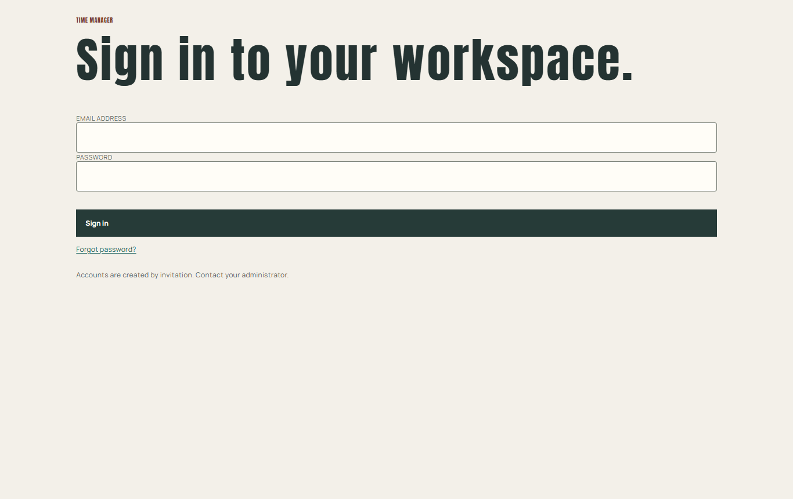 | 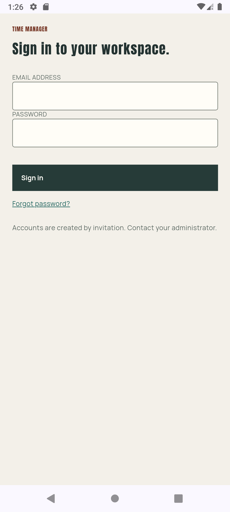 |

1. Saisissez votre **adresse email** et votre **mot de passe**.
2. Touchez **Sign in**.

**Sur mobile, la première connexion demande du réseau.** Ensuite :

- **Vous fermez l'application ?** À la réouverture, posez simplement votre **doigt** sur le capteur (ou saisissez le code du téléphone) : pas besoin de retaper votre mot de passe, même sans réseau.
- **Vous touchez « Sign out » ?** Votre session est effacée du téléphone : la prochaine connexion demandera votre mot de passe, avec du réseau.
- **Vous avez annulé l'empreinte ?** L'écran de connexion propose **« Unlock with fingerprint or PIN »** pour réessayer.

**Mot de passe oublié** : touchez **Forgot password?**, saisissez votre email, puis suivez le lien reçu.

---

## 4. Parcours employé — web

La barre du haut donne accès à toutes vos pages : **Overview**, **My time**, **My hours**, **My team**, **Profile**.

### 4.1 Votre tableau de bord (Overview)

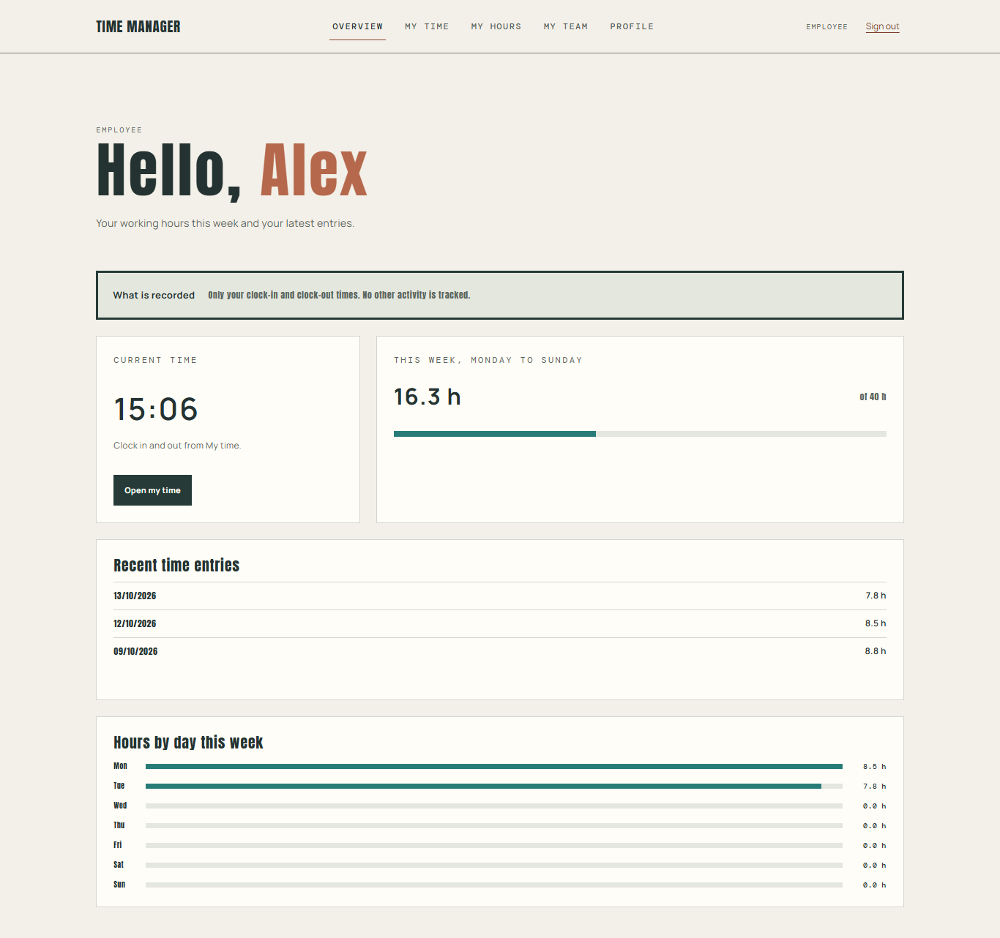

Vous y voyez d'un coup d'œil :

- le **total d'heures de la semaine** (lundi à dimanche), comparé à 40 h ;
- vos **dernières entrées** ;
- vos **heures jour par jour** de la semaine.

L'encadré **« What is recorded »** rappelle que seules vos heures d'arrivée et de départ sont enregistrées.

### 4.2 Pointer (My time → Clock in / out)

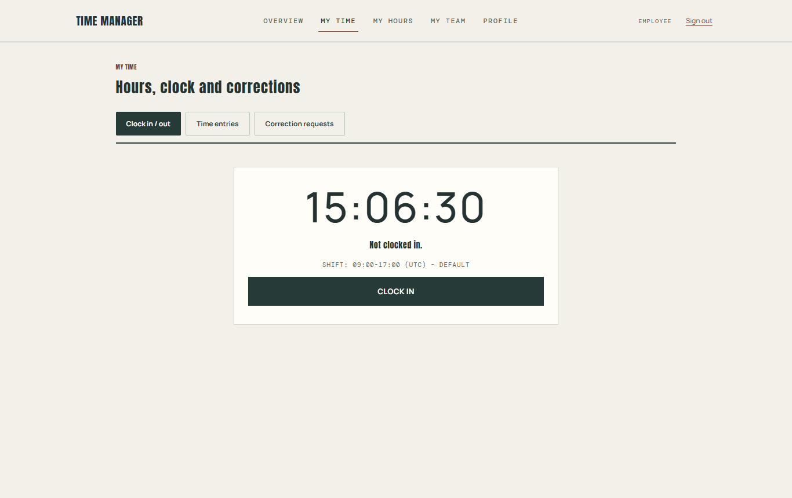

- En arrivant : touchez **CLOCK IN**. Un son montant confirme le pointage.
- En partant : touchez **CLOCK OUT**. Un son descendant le confirme.

Le temps écoulé depuis votre arrivée s'affiche en direct. Votre horaire prévu (**Shift**) est indiqué sous l'heure.

### 4.3 Consulter vos heures (My time → Time entries)

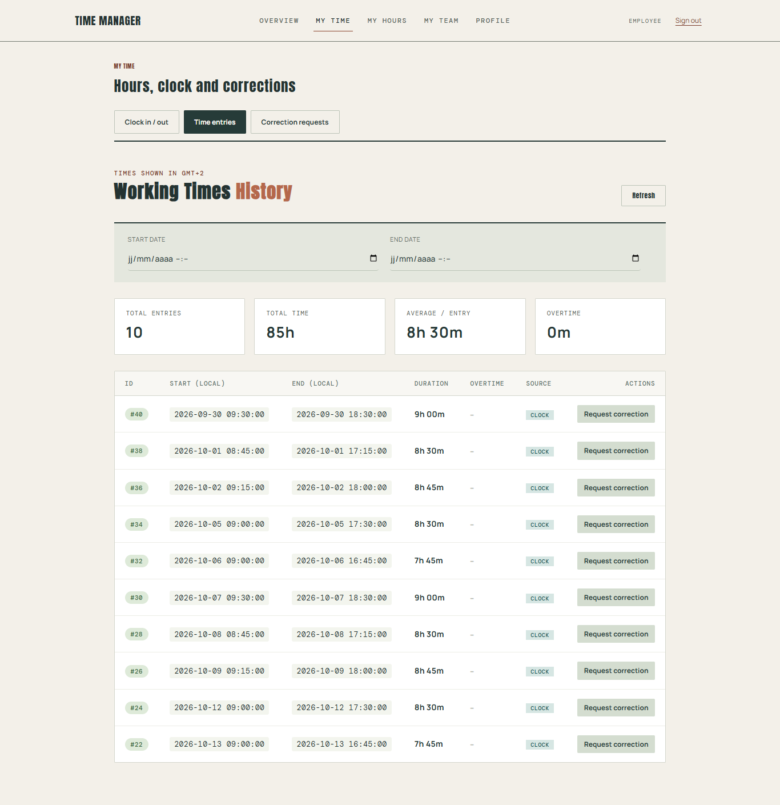

- Toutes vos entrées, avec leur **durée**.
- Les totaux : nombre d'entrées, temps total, moyenne par entrée, heures supplémentaires.
- Filtrez par période avec **START DATE** et **END DATE**.

### 4.4 Demander une correction

Vous avez oublié de pointer, ou une heure est fausse ? Dans **Time entries**, touchez **Request correction** sur la ligne concernée.

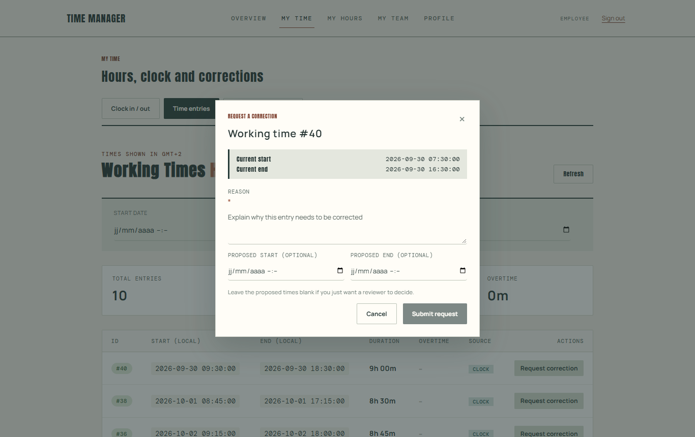

1. Expliquez la raison (**Reason**, obligatoire).
2. Proposez si besoin la bonne heure de début ou de fin.
3. Touchez **Submit request**. Votre manager la reçoit.

### 4.5 Suivre vos demandes (My time → Correction requests)

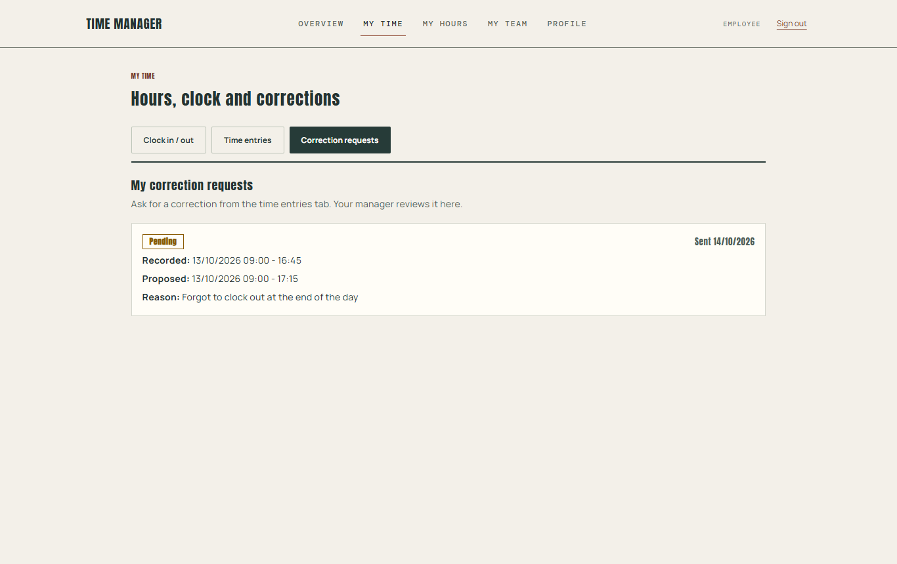

Chaque demande affiche son statut :

| Statut | Signification |
|---|---|
| **Not sent yet** | Faite hors ligne, pas encore envoyée |
| **Pending** | En attente de votre manager |
| **Approved** | Acceptée : l'entrée est corrigée |
| **Rejected** | Refusée ; la réponse du manager est indiquée |

### 4.6 Vos heures en graphiques (My hours) — web uniquement

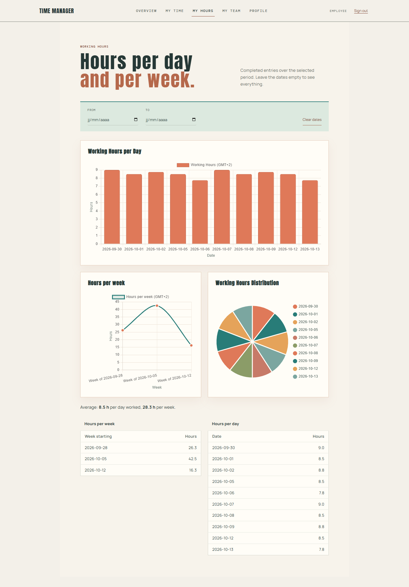

- Heures **par jour** (barres) et **par semaine** (courbe).
- **Moyennes** par jour travaillé et par semaine.
- Choisissez la période avec **From** / **To**.
- Les **tableaux** sous les graphiques donnent les mêmes valeurs en texte (utile avec un lecteur d'écran).

### 4.7 Votre équipe (My team)

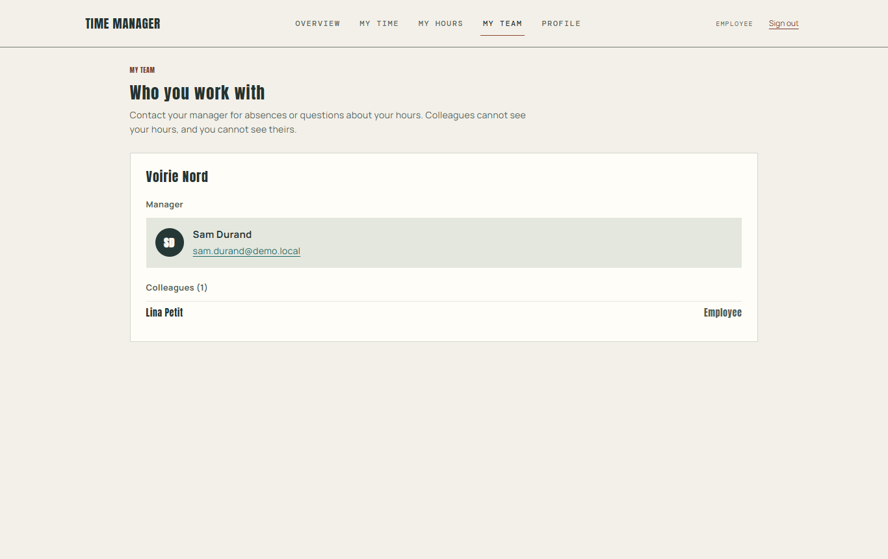

- Votre **manager**, avec son **email** : c'est à lui que vous vous adressez pour une absence ou une question sur vos heures.
- Vos **collègues** (nom et rôle).

Vos collègues ne voient pas vos heures, et vous ne voyez pas les leurs.

### 4.8 Votre compte (Profile)

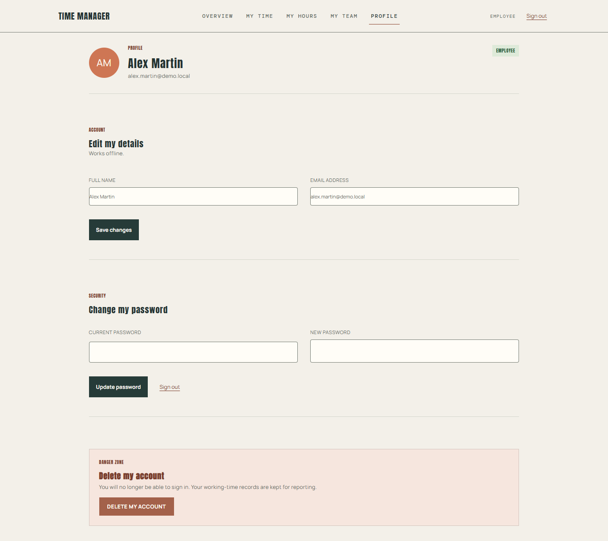

- **Edit my details** : modifier votre nom et votre email.
- **Change my password** : saisir le mot de passe actuel, puis le nouveau (au moins 10 caractères, avec minuscule, majuscule, chiffre et symbole).
- **Sign out** : se déconnecter.
- **Delete my account** : supprimer votre compte (confirmation demandée deux fois, dont la saisie de votre email). Vos heures restent conservées pour la paie.

---

## 5. Parcours employé — mobile

Sur téléphone, la barre en bas de l'écran donne accès à **My time**, **My team**, **Profile** et **Sign out**. Les tableaux de bord et graphiques sont réservés à la version web.

| Pointer | Pointé | Heures |
|---|---|---|
| 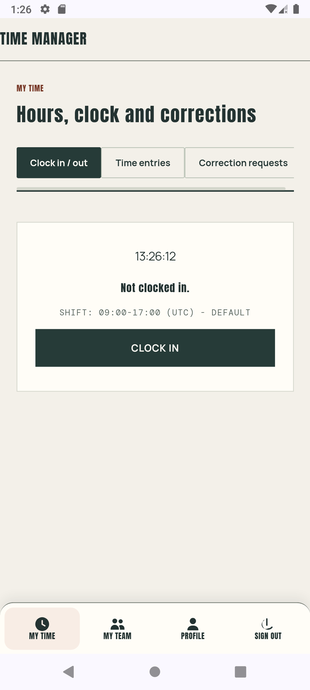 | 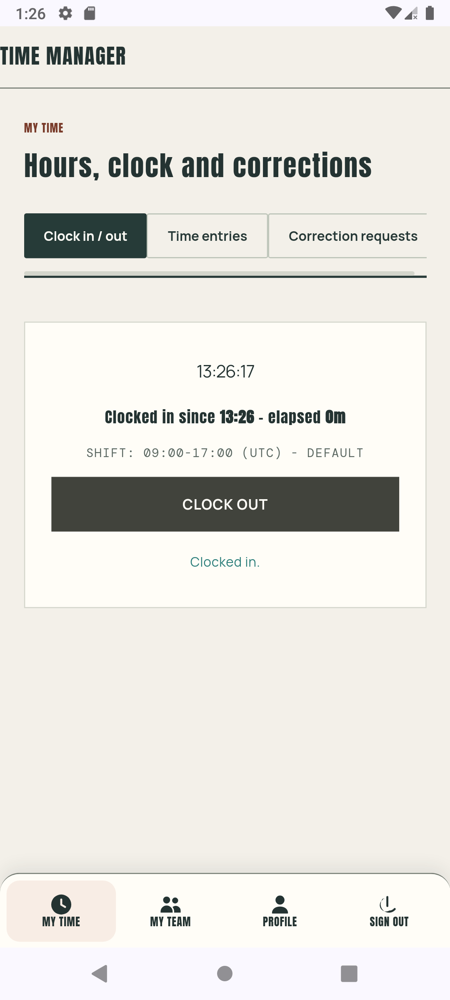 | 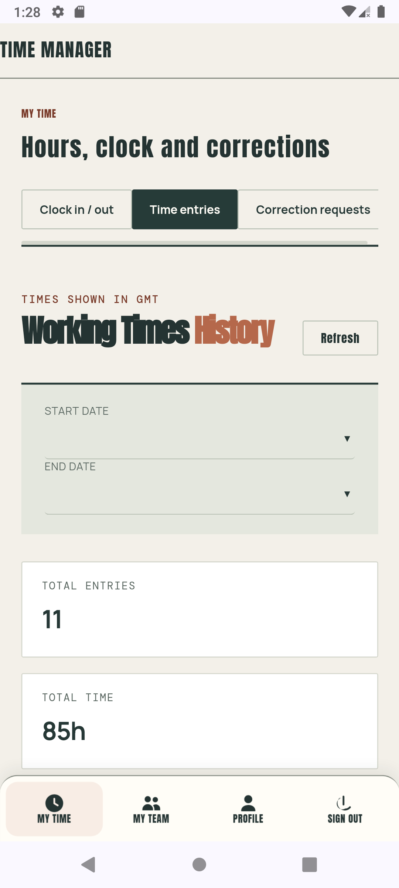 |

1. **Pointer** : l'application s'ouvre sur **My time**. Touchez **CLOCK IN** à l'arrivée, **CLOCK OUT** au départ. Le téléphone vibre et émet un son.
2. **Vos heures** : onglet **Time entries**.
3. **Demander une correction** : bouton **Request correction** sur une entrée, comme sur le web.

| Demandes | Équipe | Profil |
|---|---|---|
| 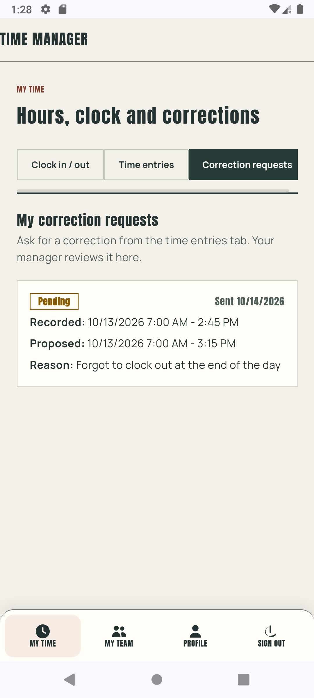 | 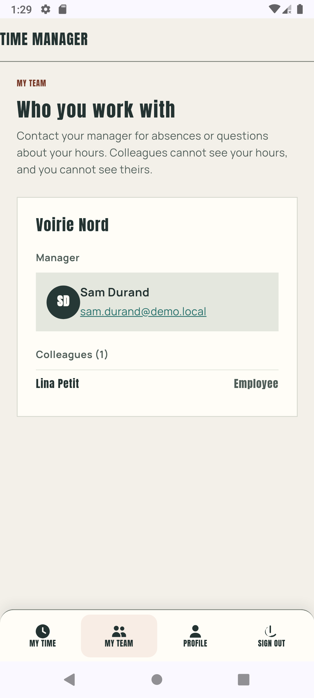 | 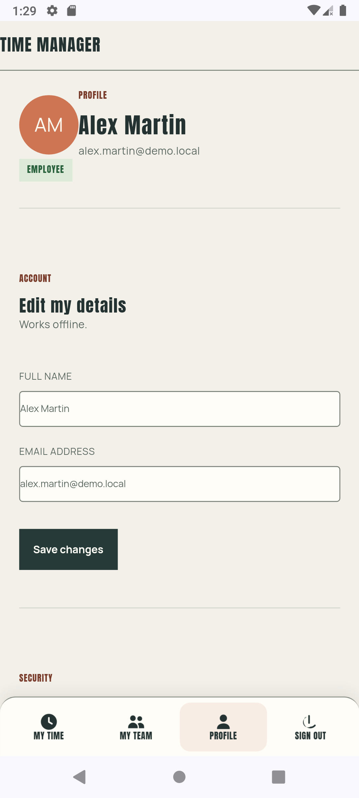 |

- **Correction requests** : le statut de vos demandes.
- **My team** : votre manager (touchez son email pour lui écrire) et vos collègues.
- **Profile** : vos informations, votre mot de passe et la déconnexion.

---

## 6. Utiliser l'application sans réseau

L'application mobile continue de fonctionner **sans réseau** (sous-sol, chantier, zone blanche…).

| Pointage hors ligne | Équipe hors ligne |
|---|---|
| 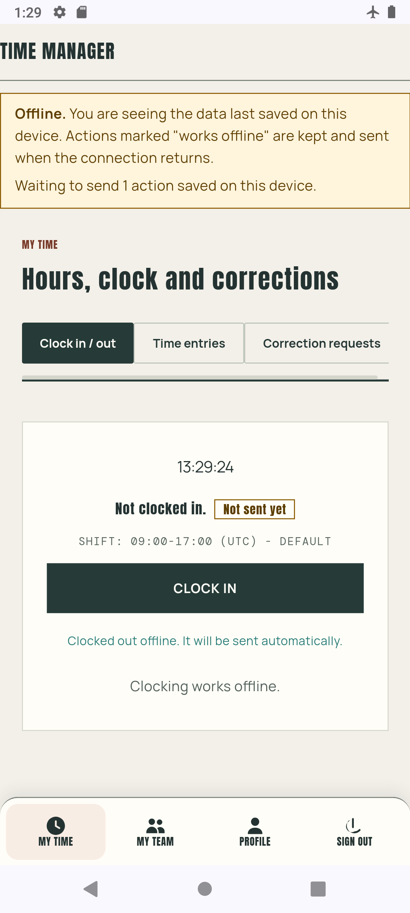 | 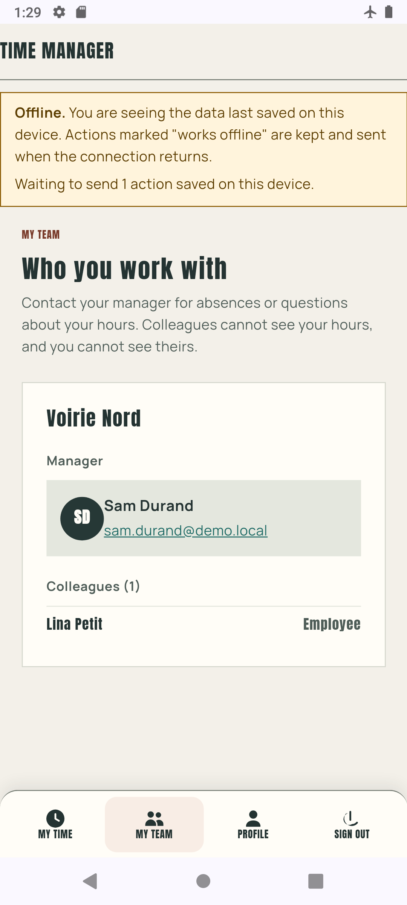 |

**Ce que vous voyez :**

- Un bandeau jaune **« Offline »** : les informations affichées sont les dernières enregistrées sur le téléphone.
- **« Waiting to send 1 action… »** : le nombre d'actions gardées sur le téléphone.
- Le badge **« Not sent yet »** sur ce qui n'est pas encore envoyé.

**Ce qui se passe :** dès que le réseau revient, les actions sont **envoyées automatiquement**, dans l'ordre. Le bandeau et les badges disparaissent. Votre pointage garde **l'heure réelle** à laquelle vous l'avez fait, pas l'heure du retour du réseau.

### Ce qui fonctionne sans réseau

| Action | Sans réseau |
|---|---|
| Pointer (arrivée / départ) | ✅ |
| Consulter vos heures, vos demandes, votre équipe, votre profil | ✅ (dernières données enregistrées) |
| Demander une correction | ✅ |
| Modifier votre nom ou votre email | ✅ |
| Managers : créer une équipe, ajouter ou retirer un membre | ✅ |
| Première connexion, changement de mot de passe, suppression de compte | ❌ réseau nécessaire |
| Inviter, changer un rôle, modifier un horaire, modifier les heures d'un autre | ❌ réseau nécessaire |

Les actions qui ne fonctionnent pas hors ligne affichent **« Connection required for this action »**.

**Bon à savoir :**

- Ouvrez au moins une fois chaque page **avec du réseau** : c'est ce qui l'enregistre sur le téléphone.
- Après **7 jours** sans aucune connexion, l'application vous demande de vous reconnecter en ligne.
- Si le serveur **refuse** une action faite hors ligne (par exemple, vous aviez déjà pointé depuis un ordinateur), le bandeau l'indique avec la raison. Demandez alors une correction à votre manager.

### Se déconnecter avec des actions en attente

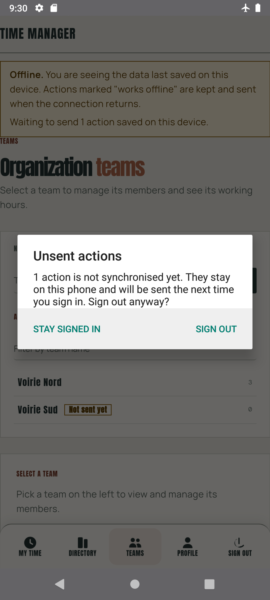

Si des actions ne sont pas encore envoyées, l'application vous prévient. **Stay signed in** vous laisse le temps de retrouver du réseau. Si vous vous déconnectez quand même, les actions restent sur le téléphone et partent à votre prochaine connexion.

---

## 7. Parcours manager

La barre du haut ajoute **Directory** et **Teams**.

### 7.1 Votre tableau de bord (web)

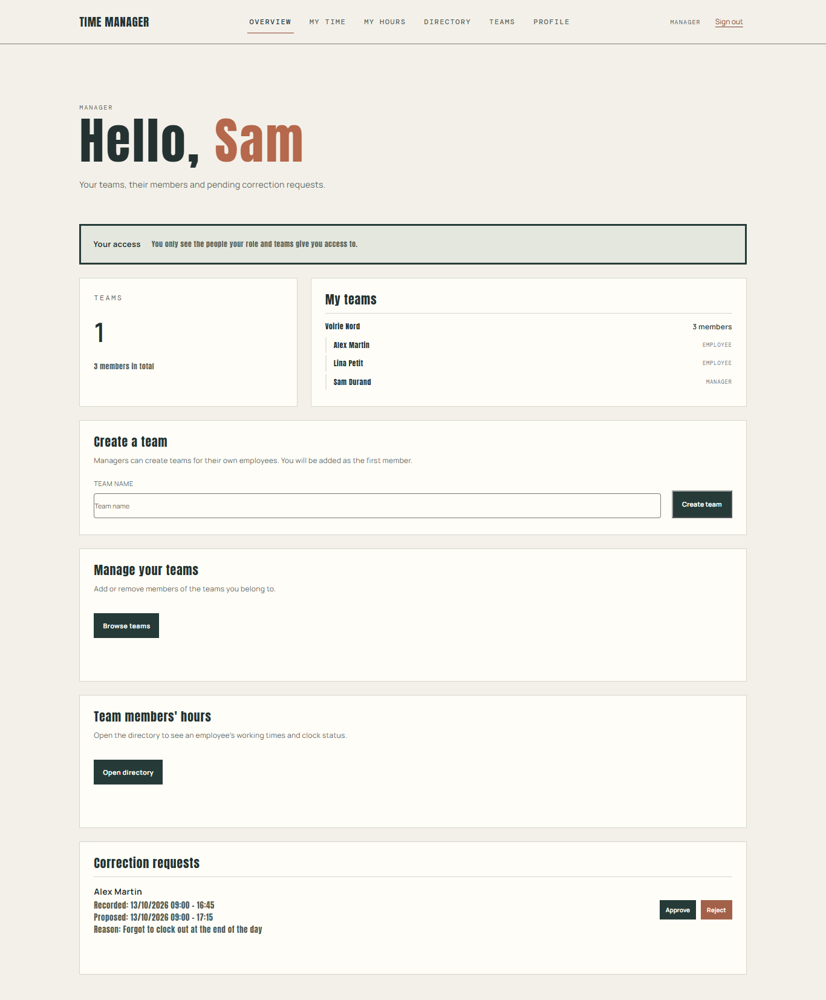

- Vos **équipes** et leurs membres.
- **Create a team** : créer une équipe (vous en devenez le premier membre).
- **Correction requests** : les demandes de vos employés, avec l'heure enregistrée, l'heure proposée et la raison. Touchez **Approve** pour corriger l'entrée, ou **Reject** pour refuser.

### 7.2 Gérer vos équipes (Teams)

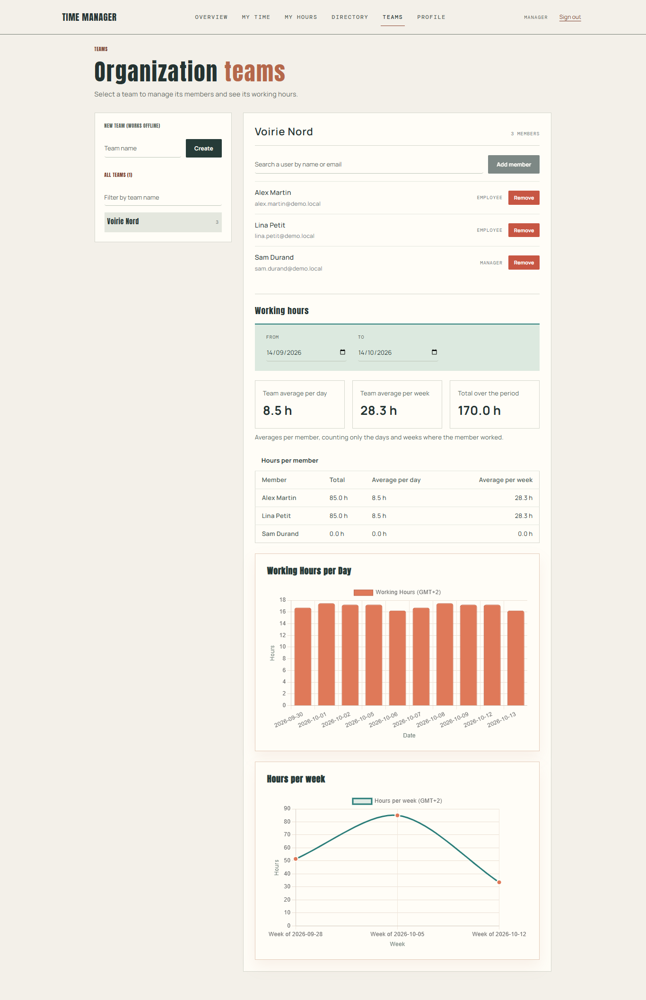

1. Choisissez une équipe dans la liste.
2. **Ajouter un membre** : cherchez une personne par son nom ou son email, puis touchez **Add member**.
3. **Retirer un membre** : touchez **Remove** sur sa ligne (confirmation demandée).
4. **Working hours** : choisissez une période pour voir :
   - la **moyenne d'heures par jour** et **par semaine** de l'équipe ;
   - le **total** ;
   - les **heures de chaque membre** ;
   - les graphiques par jour et par semaine (web).

Les moyennes ne comptent que les jours et semaines où chaque membre a travaillé.

**Sur mobile**, la page Teams fonctionne aussi **sans réseau** pour créer une équipe :

| Équipes (mobile) | Équipe créée hors ligne |
|---|---|
| 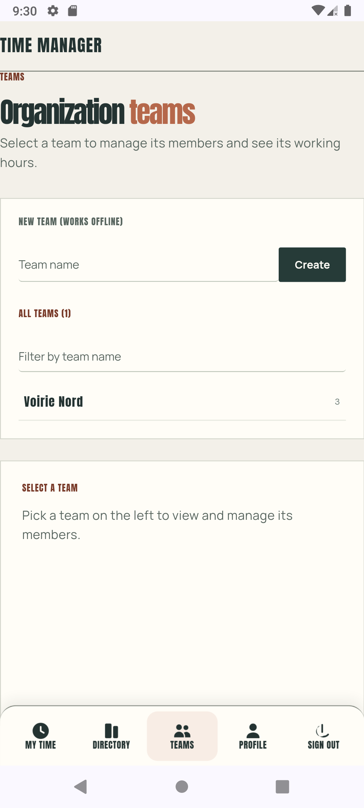 | 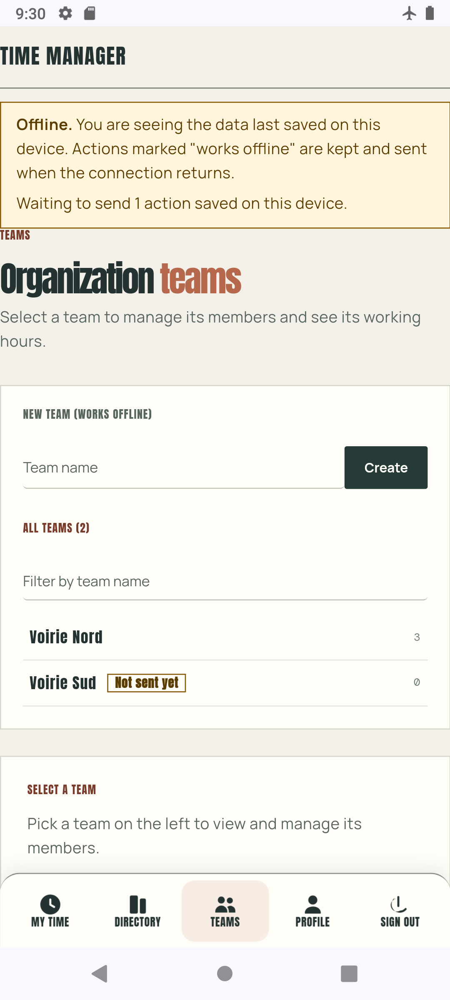 |

Une équipe créée hors ligne porte le badge **« Not sent yet »**. Vous pourrez y ajouter des membres une fois qu'elle aura été créée sur le serveur, au retour du réseau.

### 7.3 Consulter un employé (Directory)

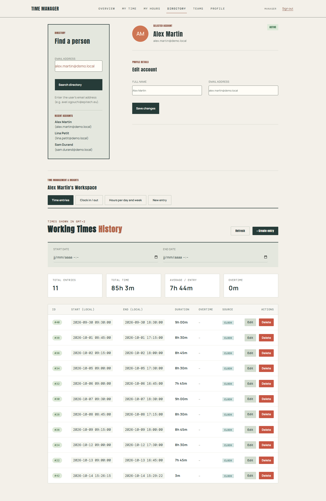

1. Cherchez une personne par son **email**, ou choisissez-la dans **Recent accounts**.
2. Sa fiche s'affiche, puis son espace de travail :
   - **Time entries** : ses heures ; **+ Create entry**, **Edit** et **Delete** pour corriger une entrée ;
   - **Clock in / out** : la pointer à sa place (avec du réseau uniquement) ;
   - **Hours per day and week** : ses heures en graphiques (web) ;
   - **New entry** : ajouter une entrée manuellement.

Vous ne voyez que les personnes de vos équipes.

---

## 8. Parcours general manager (administration)

La barre du haut ajoute **Directory** et **Admin**.

### 8.1 Vue d'ensemble

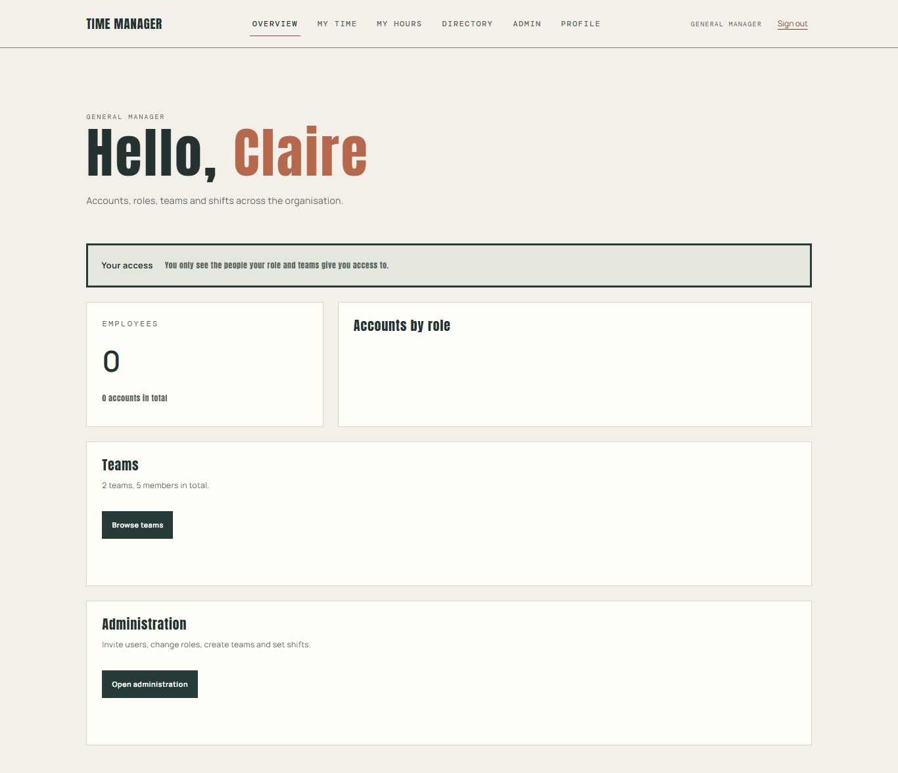

Nombre d'employés, comptes par rôle, équipes, et accès à l'administration.

### 8.2 Administration (Admin)

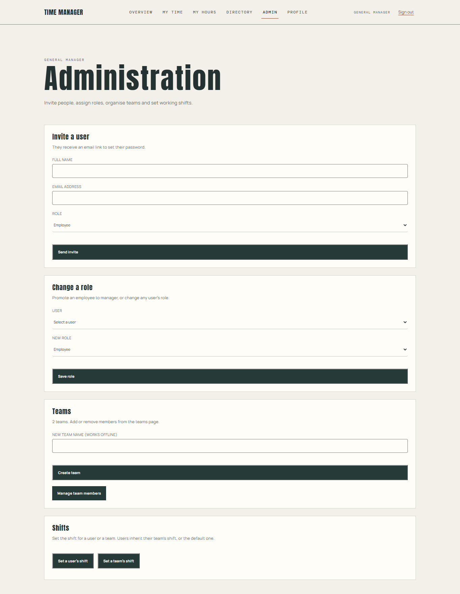

| Section | Usage |
|---|---|
| **Invite a user** | Nom, email et rôle : la personne reçoit un email pour choisir son mot de passe |
| **Change a role** | Promouvoir un employé en manager, ou changer le rôle de n'importe qui |
| **Teams** | Créer une équipe ; **Manage team members** ouvre la page Teams |
| **Shifts** | Définir l'horaire d'une personne ou d'une équipe. Une personne sans horaire propre suit celui de son équipe, sinon l'horaire par défaut |

Pour **supprimer un compte** : **Directory** → choisissez la personne → **Remove account** (confirmation demandée).

Inviter, changer un rôle, modifier un horaire et supprimer un compte demandent **du réseau** : ces actions ne sont jamais faites à partir de données qui pourraient être périmées.

---

## 9. Votre vie privée

- **Seules vos heures d'arrivée et de départ sont enregistrées.** Aucune autre activité n'est suivie.
- Vos **collègues ne voient pas vos heures**. Seuls votre manager, les RH et le general manager y ont accès.
- Votre **mot de passe n'est jamais stocké sur le téléphone**. L'application garde seulement une clé de session chiffrée, protégée par votre empreinte ou le code du téléphone.
- Après un changement de mot de passe, **tous vos appareils sont déconnectés**.

---

## 10. Questions fréquentes

**L'application affiche « No connection. The first sign-in needs the network ».**
Vous n'êtes pas connecté à internet et aucune session n'est enregistrée sur ce téléphone (première connexion, ou après « Sign out »). Connectez-vous une fois avec du réseau (Wi-Fi ou données mobiles).

**L'application affiche « This phone has no screen lock… ».**
Définissez un code, un schéma ou une empreinte dans les réglages du téléphone, puis reconnectez-vous.

**On ne me demande pas mon empreinte à l'ouverture.**
Vous vous êtes déconnecté avec **Sign out** : la session a été effacée. Reconnectez-vous avec votre mot de passe ; ensuite, fermez simplement l'application au lieu de vous déconnecter.

**On me redemande mon mot de passe alors que je n'ai rien fait.**
Votre mot de passe a été changé (même depuis un ordinateur), votre session a expiré (plus de 7 jours sans connexion) ou votre compte a été modifié par un administrateur.

**Une page affiche « not saved on this device yet ».**
Elle n'a jamais été ouverte avec du réseau sur ce téléphone. Ouvrez-la une fois en ligne.

**Mon pointage fait hors ligne a été refusé.**
Le bandeau indique la raison (par exemple, un pointage déjà fait depuis un ordinateur). Faites une **demande de correction** depuis **My time → Time entries**.

**J'ai pointé hors ligne : quelle heure est enregistrée ?**
L'heure réelle de votre pointage. Si elle paraît incohérente (par exemple, l'horloge du téléphone est fausse), c'est l'heure de réception qui est gardée, et votre manager est invité à vérifier l'entrée.
